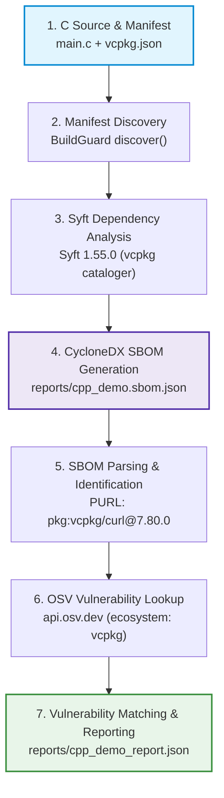

# BuildGuard P1 C/C++ Dependency Analyzer — Demonstration & Presentation Guide

This guide is designed for a developer or student presenting the completed **BuildGuard P1 Dependency Scanner C/C++ Prototype** to a technical evaluator. It explains the end-to-end architecture, demonstrates live CLI execution, and breaks down each stage of the analysis workflow.

---

## 1. End-to-End Architecture & Workflow

The C/C++ dependency analysis pipeline executes a 7-stage workflow connecting genuine C source code, package manifests, Syft SBOM generation, OSV vulnerability intelligence, and structured BuildGuard reporting:



---

## 2. Topic-by-Topic Presentation Guide

### 1. What the C Program Does
The demonstration project `test_samples/deps_vuln_cpp/main.c` is a genuine C program utilizing the external `libcurl` C library (`<curl/curl.h>`). It initializes the curl runtime (`curl_global_init`, `curl_easy_init`), sets transfer options (HTTP target URL, follow redirects, response write callback, timeout), performs an HTTP GET transaction (`curl_easy_perform`), inspects the HTTP response status code, and cleans up curl resources.

### 2. Why a Dependency Manifest is Necessary
In C/C++, header inclusion directives (e.g., `#include <curl/curl.h>`) do not declare dependency versions, package origins, integrity hashes, or distribution sources. Scanning C/C++ source code alone cannot determine whether `libcurl` is version `7.80.0` or `8.5.0`. A formal package manifest such as `vcpkg.json` (or `conanfile.txt`) explicitly declares package dependencies, version constraints (`version>= 7.80.0`), and registry/overlay configuration, providing the deterministic identity needed for security analysis.

### 3. What BuildGuard Discovers
BuildGuard's `discover()` engine recursively traverses the project directory, skipping transient folders (`node_modules`, `.git`, `.venv`, `.buildguard`). It identifies C/C++ manifests (`vcpkg.json`, `vcpkg-configuration.json`, `conanfile.txt`, `conan.lock`) alongside existing package manifests across supported ecosystems. It detects the project language as C and points file hints directly to `vcpkg.json`.

### 4. What Syft Does
Anchore Syft (installed version **1.55.0**) is invoked via CLI (`syft scan dir:<path> -o cyclonedx-json=<out>`). Syft executes its dedicated catalogers—specifically the `vcpkg-manifest-cataloger` (and `conan-cataloger`). It parses the manifest hierarchy and local overlay ports (`ports/curl/vcpkg.json`), resolving `curl` to version `7.80.0` without requiring live network access or git repository clones.

### 5. What an SBOM is and Why CycloneDX is Used
A **Software Bill of Materials (SBOM)** is a machine-readable inventory of software components, dependencies, and metadata. BuildGuard uses **CycloneDX JSON** (spec version 1.7) because it is an industry-standard format natively output by Syft that provides Package URLs (PURLs), component types, CPE identifiers, and provenance evidence.

### 6. How BuildGuard Extracts Package Identities from the SBOM
BuildGuard parses the CycloneDX JSON components, extracting the PURL (e.g., `pkg:vcpkg/curl@7.80.0`). BuildGuard's `parse_purl()` strips URL prefixes and decodes the package identifier into a structured tuple:
- **Ecosystem:** `vcpkg`
- **Name:** `curl`
- **Version:** `7.80.0`

Root manifest self-references (e.g., `deps-vuln-cpp`) are automatically filtered out, ensuring only actual third-party dependencies are analyzed.

### 7. What OSV Does and How Package Versions are Queried
Google's **Open Source Vulnerabilities (OSV)** database (`https://api.osv.dev`) provides an API for querying open-source package vulnerabilities using standardized ecosystem names. BuildGuard maps the extracted ecosystem (`vcpkg` → `vcpkg`, `conan` → `ConanCenter`) and queries the OSV batch endpoint (`/v1/querybatch`) with:
```json
{
  "package": {
    "name": "curl",
    "ecosystem": "vcpkg"
  },
  "version": "7.80.0"
}
```
Queries are cached locally under `.buildguard/cache/osv/` to support high-performance offline scans.

### 8. How Vulnerabilities are Matched
When OSV returns advisory records, BuildGuard parses each vulnerability object (`/v1/vulns/{id}`). It checks affected version ranges, extracts Common Weakness Enumerations (CWEs), aliases (CVE / GHSA identifiers), and remediation versions (`fixed_in`). If malicious packages are identified (`MAL-*`), they are separated from security advisories.

### 9. How Severity and Confidence are Represented
- **Severity:** Evaluated using CVSS scores, database-specific severities, or advisory metrics (`CRITICAL`, `HIGH`, `MEDIUM`, `LOW`, `INFO`).
- **Confidence:** Verified package advisory matches are marked `CONFIRMED`; heuristic indicators are marked `HIGH`, `MEDIUM`, or `LOW`.
- Clean packages with zero advisories receive `NO_KNOWN_ISSUES` with `INFO` severity and `LOW` confidence.

### 10. How the Final JSON Report is Generated
BuildGuard aggregates findings, execution errors, checks performed, and tool versions into a standard `ModuleResult` object. The report is serialized to JSON with 2-space indentation and saved to the specified output file (`reports/cpp_demo_report.json`).

### 11. Exact Terminal Commands for Running the Demo

Run the end-to-end scanner with full stage visibility and structured report generation:

```bash
.venv/bin/python -m modules.dependency_scanner \
  test_samples/deps_vuln_cpp \
  --verbose \
  --out reports/cpp_demo_report.json
```

To run completely offline using cached OSV intelligence:

```bash
.venv/bin/python -m modules.dependency_scanner \
  test_samples/deps_vuln_cpp \
  --offline \
  --verbose \
  --out reports/cpp_demo_report.json
```

### 12. How to Inspect the Intermediate SBOM and Final Report

Inspect the intermediate CycloneDX SBOM generated by Syft:
```bash
cat reports/cpp_demo.sbom.json | jq .
```

Verify the detected components in the SBOM:
```bash
python3 -c "
import json
with open('reports/cpp_demo.sbom.json') as f:
    sbom = json.load(f)
print('Spec:', sbom.get('specVersion'))
print('Components:', [(c['name'], c['version'], c.get('purl')) for c in sbom.get('components', []) if c.get('type') == 'library'])
"
```

Inspect the final BuildGuard JSON report:
```bash
cat reports/cpp_demo_report.json | jq .
```

### 13. Difference Between "No Known Vulnerabilities" and an Unsuccessful Lookup
- **`NO_KNOWN_ISSUES`**: The package manifest was discovered, Syft successfully extracted the package identity and exact version, the OSV query completed successfully (HTTP 200), and OSV confirmed 0 matching advisories for that exact package version.
- **`UNRESOLVED` (osv_unreachable)**: The network failed, the request timed out, or HTTP 5xx errors occurred. BuildGuard **never** claims clean status on network failures; it issues an `UNRESOLVED` finding and marks scan status as `partial`.
- **`UNRESOLVED` (no_exact_version)**: The package was declared without an exact pinned version.
- **`UNRESOLVED` (unsupported_ecosystem)**: The ecosystem is not supported by the vulnerability intelligence database.

### 14. Current Limitations
- **OSV Advisory Coverage:** The OSV database only reports vulnerabilities present in its published feeds. For C/C++ ecosystems (`vcpkg` and `ConanCenter`), OSV currently catalogs advisories where upstream feeds provide mappings; packages without OSV entries return zero advisories.
- **Manifest Pinning Required:** Source-level C `#include` statements without a package manifest (`vcpkg.json` or `conanfile.txt`) cannot provide dependency version identities.

---

## 3. Verification & Test Suite Execution

All changes comply with repository standards and pass all validation gates:

```bash
# 1. Bytecode syntax validation
python -m py_compile modules/dependency_scanner/*.py

# 2. Automated test suite (73 passing unit & regression tests)
pytest -q modules/dependency_scanner/tests

# 3. Code formatting & whitespace compliance
git diff --check
```
